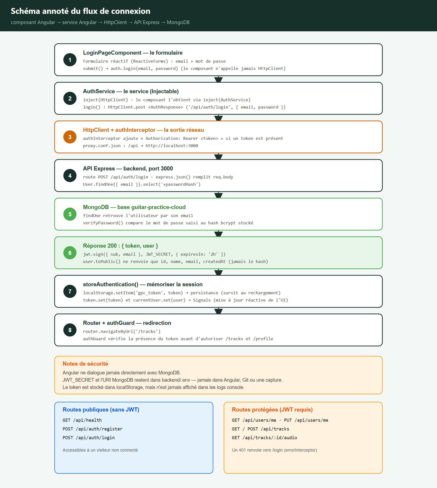
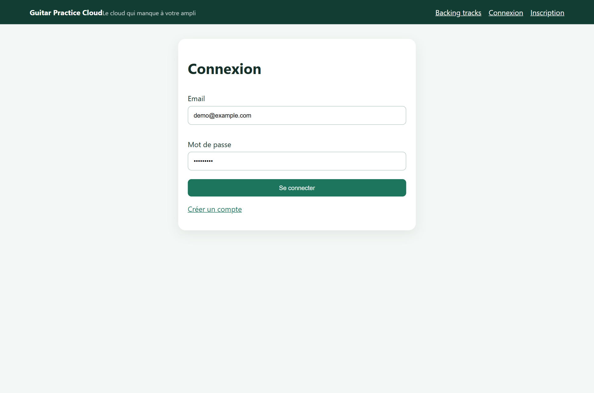
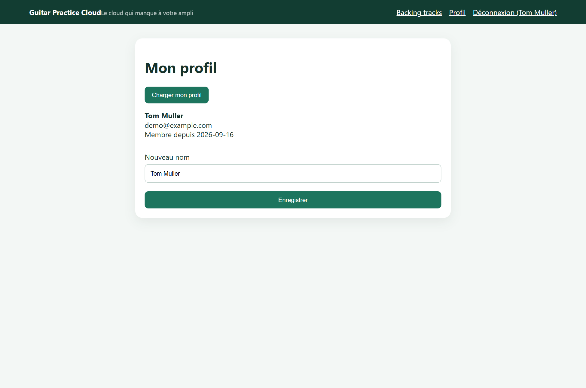

# Rapport d'usage de l'IA — TP1 / TP2 / TP3

Assistant utilisé : **Hermes Agent** (Nous Research), modèle **deepseek-v4.1-flash**.

---

## Mission 0 — Cartographier l'application (TP1)

- **Objectif** : repérer où se trouve chaque responsabilité Angular et décrire le flux d'une connexion.
- **Prompt principal** : « cartographie l'application : composant racine, routes, enregistrement de `HttpClient`, modèles, services, pages, et le mécanisme qui ajoute le JWT ».
- **Plan de l'agent** : lire `main.ts`, `routes.ts`, `auth.service.ts`, `auth.interceptor.ts`, puis produire un schéma annoté du flux.
- **Vérifications** : lecture directe des fichiers du projet ; aucune modification de code à cette étape.
- **Erreurs / propositions rejetées** : première version du schéma illisible (texte tronqué dans deux blocs) → schéma refait en flux vertical.
- **Fichiers modifiés** : aucun (mission d'observation).
- **Preuve** : `captures/07-schema-flux-connexion.png`.

- **Ce qu'on sait expliquer sans l'agent** : le trajet complet `LoginPageComponent → AuthService → HttpClient → Express → MongoDB`, et la différence entre routes publiques et protégées.

---

## Mission 1 — Inscription, connexion, profil (TP1)

- **Objectif** : mettre en place les formulaires, les appels d'API, l'état d'authentification et le profil.
- **Prompt principal** : « complète la partie utilisateur du frontend (formulaires réactifs, appels `/api/auth/*` et `/api/users/me`, Signal `currentUser`, déconnexion, gestion du 401) ».
- **Plan de l'agent** : vérifier le code existant, corriger ce qui empêche l'authentification de fonctionner, ajouter ce qui manque, puis tester l'application dans un navigateur.
- **Vérifications** : build Angular, tests des routes de l'API, puis parcours réel de l'application avec captures d'écran.
- **Erreurs / propositions rejetées** :
  - l'en-tête `Authorization` était mal écrit dans l'intercepteur → le jeton n'était jamais envoyé ;
  - le nom du profil s'est d'abord mal saisi lors des captures (texte inséré au milieu du champ) → méthode de saisie corrigée et capture refaite.
- **Fichiers modifiés** : `auth.interceptor.ts`, `error.interceptor.ts` (nouveau), `main.ts`, `app.ts`, `app.html`, `app.css`.
- **Preuves** : `captures/01` à `11`, et les captures Network `captures/network-01` à `04`.

- **Ce qu'on sait expliquer sans l'agent** : comment un formulaire réactif appelle un service, comment le jeton est mémorisé et renvoyé, et pourquoi un Signal met l'interface à jour.

---

## Mission 2 — Bibliothèque paginée (TP2)

- **Objectif** : pagination serveur, état en Signals, cartes de bibliothèque.
- **Prompt principal** : « implémente la bibliothèque paginée : `TrackService.list(page, limit)` avec paramètres réels, Signals `tracks/page/pages/loading/error`, `@for`/`@empty`/`@if`, boutons Précédent/Suivant désactivés aux bornes, cartes responsives et accessibles ; option AVANCÉ : Paginator Angular Material ».
- **Plan de l'agent** : lire `track.service.ts`, `tracks-page.*`, `page.model.ts` et le contrat HTTP ; implémenter l'état ; vérifier par build, tests et parcours réel dans un navigateur ; ajouter le thème et le paginator Material.
- **Vérifications** : `npm run build`, `npm test` (45 tests après les bonus), puis parcours réel avec captures d'écran et relevé des échanges réseau (page 1 → page 2).
- **Erreurs / propositions rejetées** :
  - **le formulaire d'import ne soumettait rien** : `(ngSubmit)` sur un `<form>` sans directive de formulaire (`[formGroup]`/`ngForm`) ne s'exécute pas, la soumission HTML native rechargeait donc la page. Détecté en pilotant réellement l'application ; corrigé par `(submit)="upload(); $event.preventDefault()"` ;
  - **le pourcentage d'upload restait à 0 %** : le code utilisait `event.total ?? file.size`, or pour un `multipart/form-data` le navigateur renvoie `total = 0` (et non `undefined`). Corrigé par `event.total || file.size` ;
  - première proposition de n'utiliser qu'un seul contrôle de pagination : deux contrôles complémentaires ont été préférés (boutons explicites exigés par le sujet **et** paginator Material de l'option avancée), pilotant les mêmes signaux ;
  - l'option « Pagination Mongoose (`aggregate-paginate-v2`) » n'a pas été retenue
    pour la mission principale (facultative, elle impose de modifier le backend) ;
    elle a été réalisée plus tard, au titre des bonus — voir la mission 8.
- **Fichiers modifiés** : `shared/services/track.service.ts`, `components/tracks-page/tracks-page.{ts,html,css}`, `src/styles.css`, `shared/utils/format.ts` *(nouveau)*, `shared/utils/audio-file.ts` *(nouveau)*, `shared/utils/http-error.ts` *(nouveau)*, `angular.json`, `package.json`.
- **Preuves** : `captures/12`, `13`, `14`, `15`, `16`, `19`, `20` et `captures/network-05` à `07`.

- **Ce qu'on sait expliquer sans l'agent** : pourquoi la pagination est faite par le serveur, la différence entre un Signal et `localStorage`, et pourquoi on passe par un `Blob` + `ObjectURL` plutôt qu'une URL placée dans `src`.

---

## Mission 3 — Upload et lecture audio (TP2)

- **Objectif** : identifier et compléter le flux d'upload et de lecture sécurisée, sans changer le contrat HTTP.
- **Prompt principal** : « identifie où se font le choix du fichier, le `FormData`, l'appel d'upload, le `Blob`, l'`ObjectURL` et la révocation ; complète la validation avant appel HTTP, les états d'envoi (chargement, anti double soumission, erreurs, succès, remise à zéro) et la lecture (morceau en cours, erreur compréhensible, révocation finale) ».
- **Plan de l'agent** : cartographier les fichiers concernés, comparer les contrôles backend (Multer) et frontend, implémenter les manques, vérifier par tests unitaires et par un upload réel.
- **Vérifications** : `npm test`, upload réel de 6 fichiers (dont un de 13,7 Mo), lecture authentifiée, relecture des en-têtes dans les échanges réseau capturés.
- **Erreurs / propositions rejetées** :
  - le pourcentage restait bloqué à `0 %` en test réel (cause ci-dessus) ;
  - la validation frontend a été alignée sur la liste MIME **et** les extensions, car certains systèmes ne renseignent pas le type MIME ;
  - l'idée initiale de vérifier la validation serveur en contournant l'interface a été abandonnée : un test de contrat backend couvre le `400` de façon plus honnête et reproductible.
- **Fichiers modifiés** : `track.service.ts`, `tracks-page.ts/html/css`, `shared/utils/audio-file.ts`, `shared/utils/http-error.ts`.
- **Preuves** : `captures/13`, `14`, `15`, `16`, `network-06`, `network-07`, `reseau-multipart.json`.

- **Ce qu'on sait expliquer sans l'agent** : pourquoi une URL dans `src` ne reçoit pas l'en-tête `Authorization`, pourquoi `URL.createObjectURL` doit être révoquée, et pourquoi la validation frontend ne remplace jamais celle du backend.

---

## Mission 5 — Suppression d'une piste (TP3)

- **Objectif** : suppression confirmée, sans double clic, avec message et mise à jour de la liste.
- **Prompt principal** : « ajoute la suppression via `TrackService.remove()` : action dans la carte, confirmation, état `deletingId`, SnackBar de succès/erreur, rechargement de la page, et gestion d'un 404 (piste déjà supprimée ou appartenant à quelqu'un d'autre) ».
- **Plan de l'agent** : lire le service et le composant, préférer une confirmation _inline_ (deux boutons) à une boîte de dialogue, puis vérifier par test de composant et par un parcours réel.
- **Vérifications** : test unitaire (DELETE puis rechargement, cas 404), suppression réelle dans le navigateur (`DELETE` → `204`, SnackBar, liste rechargée).
- **Erreurs / propositions rejetées** :
  - `window.confirm()` écarté (peu accessible, non testable proprement) au profit d'un état `pendingDeleteId` dans la carte ;
  - le premier essai de capture automatique a échoué : l'attente d'une réponse
    réseau précise ne se déclenchait jamais (le prédicat était mal formé). Les
    captures ont été reprises avec `puppeteer-core` pilotant le Chrome réellement
    installé, en attendant explicitement l'apparition du texte de succès dans la
    page plutôt qu'un événement réseau.
- **Fichiers modifiés** : `tracks-page.ts/html/css`, `track.service.ts` (`remove`).
- **Preuves** : `captures/17`, `18`, `network-08`.

- **Ce qu'on sait expliquer sans l'agent** : pourquoi le guard et l'interface ne sécurisent rien, et où le backend vérifie réellement le propriétaire.

---

## Mission 6 — Progression de l'upload (TP3)

- **Objectif** : afficher les quatre états d'un envoi (aucun, en cours avec pourcentage, réussi, échoué).
- **Prompt principal** : « fais évoluer l'upload pour afficher sa progression avec les événements HTTP d'Angular (`observe: 'events'` + `reportProgress`), distingue les quatre états, désactive les contrôles et empêche une seconde soumission ».
- **Plan de l'agent** : remplacer une paire de booléens par un `uploadPhase` explicite, traiter `UploadProgress` et `Response`, vérifier par test unitaire puis en vrai.
- **Vérifications** : test unitaire (événement `loaded = 50 / total = 100` → `50 %`, puis `400` → état `error`), upload réel, relevé de la barre de progression.
- **Erreurs / propositions rejetées** :
  - le `total` renvoyé par Chromium pour un multipart vaut `0` : le calcul a été corrigé (`||` au lieu de `??`) ;
  - l'annonce d'un pourcentage intermédiaire n'est pas observable en boucle locale (Chromium remet tout le corps à la couche réseau avant de compter les octets, même en ralentissant l'envoi à ~660 ko/s via un proxy local). Constat documenté honnêtement dans `RAPPORT_TP2.md` § 3.4 plutôt que masqué par une capture truquée.
- **Fichiers modifiés** : `track.service.ts` (`upload`), `tracks-page.ts/html/css`, `src/styles.css` (SnackBar).
- **Preuves** : `captures/13`, `14`, `network-06`.

- **Ce qu'on sait expliquer sans l'agent** : la différence entre une requête à réponse finale et un transfert long qui émet des événements intermédiaires.

---

## Mission 7 — Tests automatisés (TP3)

- **Objectif** : au moins trois tests frontend, plus une extension backend facultative.
- **Prompt principal** : « écris des tests Vitest pour `AuthService.login`, `TrackService.list/upload/remove`, l'intercepteur, le guard et le composant (erreur, pagination, suppression, progression, lecture) ; ajoute ensuite les tests de contrat et de sécurité backend (401 sans JWT, JWT invalide, upload sans fichier, MIME refusé, pagination, accès interdit) ».
- **Plan de l'agent** : configurer le runner (`tsconfig.spec.json`, `jsdom`), écrire les tests service par service, les exécuter, corriger les écarts.
- **Vérifications** : `npm test` → 6 fichiers / 35 tests passés à ce moment-là
  (45 après les bonus) ; `npm test` (backend) → 9 passés + 3 ignorés sans base,
  `npm run test:db` → 12/12 (puis 16/16 après les bonus).
- **Erreurs / propositions rejetées** :
  - `"types": ["vitest/globals"]` dans `tsconfig.spec.json` cassait la résolution des types (`@angular/core/testing` introuvable) : remplacé par des imports explicites depuis `'vitest'` ;
  - `jsdom` manquait : installé en dépendance de développement (le runner Angular l'exige hors navigateur) ;
  - deux tests ont d'abord échoué par ma faute (attente du message générique alors que le message du serveur est prioritaire ; changement de page sur une bibliothèque d'une seule page) : les attentes ont été alignées sur le comportement réel, pas l'inverse ;
  - les tests qui interrogent MongoDB se déclarent ignorés (`t.skip`) quand la base est absente, pour garder une suite verte et honnête.
- **Fichiers modifiés** : 5 fichiers `.spec.ts` *(nouveaux)* + `format.spec.ts`, `tsconfig.spec.json` *(nouveau)*, `tsconfig.app.json`, `angular.json`, `package.json`, `backend/test/api.test.js`, `backend/package.json`.
- **Preuves** : sections 4 et 5 de `RAPPORT_TP3.md`.
- **Ce qu'on sait expliquer sans l'agent** : pourquoi un test HTTP n'a pas besoin de MongoDB, ce que vérifie un test d'intercepteur ou de guard, et la différence entre test unitaire et test d'intégration.

---

## Mission 8 — Bonus facultatifs du TP2 (après la séance)

- **Objectif** : réaliser les trois options facultatives du TP2 — filtre par titre, pagination Mongoose, image de couverture — et mettre à jour le rapport de chaque TP.
- **Prompt principal** : « tu peux aussi faire les bonus facultatifs si pas déjà fait pour chaque TD, pense à mettre à jour les rapports de chaque TD ».
- **Plan de l'agent** : relire les trois sujets pour recenser les bonus (le TP1 n'en a aucun, celui du TP3 était déjà fait), installer le plugin, écrire **d'abord** le backend et le valider par HTTP, puis le frontend, puis les tests, puis refaire les captures.
- **Vérifications** : 16 tests backend et 45 tests frontend passés ; 14 captures refaites avec la nouvelle interface ; requêtes relues dans l'onglet Network (`GET /api/tracks?page=1&limit=5&q=blues` → `200`, `POST /api/tracks` → `201`, `GET /api/tracks/:id/cover` → 99,3 Ko).
- **Erreurs / propositions rejetées** :
  - **régression réelle, détectée par les tests** : une agrégation Mongoose ne convertit pas une chaîne en `ObjectId` comme le fait `find()`, donc le `$match` sur `ownerId` ne renvoyait rien et la bibliothèque s'affichait vide. Corrigé par une validation `mongoose.Types.ObjectId.isValid()` suivie d'une conversion explicite ;
  - le premier relevé de captures montrait un filtre sur « blues » **sans résultat** (aucune piste de ce nom n'existait encore) : le script a été réordonné pour filtrer après l'envoi d'un morceau nommé « Blues en Mi » ;
  - l'échappement des caractères d'expression régulière dans `q` n'était pas prévu au départ : sans lui, `q=.*` renvoyait toute la bibliothèque au lieu de rien. Un test le vérifie désormais ;
  - une première version du rapport TP2 annonçait `pages = 1` : le chiffre venait d'un appel de contrôle en `limit=20`, alors que l'interface demande `limit=5`. Corrigé après relecture.
- **Fichiers modifiés** : `backend/src/app.js`, `backend/src/models/Track.js`, `backend/package.json`, `backend/test/api.test.js`, `shared/services/track.service.ts`, `shared/models/track.model.ts`, `shared/models/page.model.ts`, `shared/utils/cover-file.ts` *(nouveau)*, `components/tracks-page/tracks-page.{ts,html,css}`, `API_CONTRACT.md`, `README.md`, `RAPPORT_TP2.md`, `RAPPORT_TP3.md`.
- **Preuves** : `captures/21` à `23`, `captures/network-09` à `11`, et la section 8 de `RAPPORT_TP2.md`.

- **Ce qu'on sait expliquer sans l'agent** : pourquoi le filtre doit être appliqué par le serveur et non sur la page affichée, pourquoi une agrégation se comporte différemment d'un `find()` sur les types, et pourquoi le nom du fichier de couverture n'est jamais exposé au client.

---

## Blocage rencontré et décision

- **Constat** : la CLI Angular 22.1.6 refuse de démarrer avec le Node.js 24.13.1
  installé au départ (`npm run build` et `npm test` échouent tous les deux avant
  même de compiler) ; il faut Node.js ≥ 24.15.0 (ou 22.22.3+).
- **Décision** : Node.js **24.15.0** a été installé dans
  `%LOCALAPPDATA%\nodejs-v24` et utilisé pour toutes les vérifications. La
  contrainte est documentée dans le `README.md` pour que la machine de restitution
  soit mise à jour.

---

## Questions du sujet sur l'IA

- **Quel modèle utilise-t-on ?** `deepseek-v4.1-flash`, dans l'assistant Hermes Agent.
- **Comment savoir combien de tokens on a consommés ?** Chaque appel d'API renvoie un décompte
  d'usage (`prompt_tokens`, `completion_tokens`, `total_tokens`) ; les fournisseurs affichent aussi
  ce total dans leur tableau de bord. Les tokens sont des morceaux de mots : la facturation se fait
  au nombre de tokens lus + écrits.
- **Qui peut conseiller le meilleur modèle pour une tâche ?** Les pages de tarification et les
  comparaisons des fournisseurs (OpenAI, Anthropic, Google, Mistral…), les classements publics
  (LMArena, Artificial Analysis), et le professeur pour le cadre du cours.