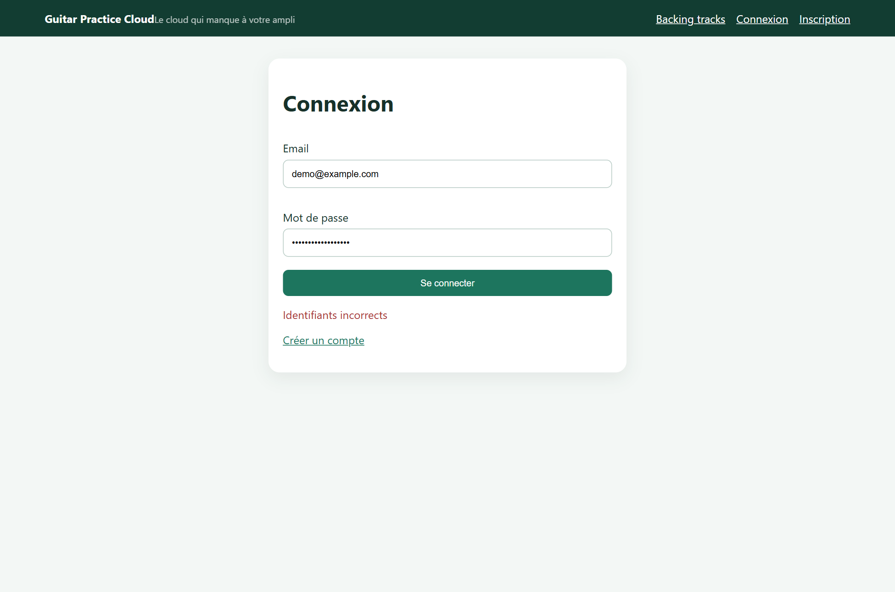
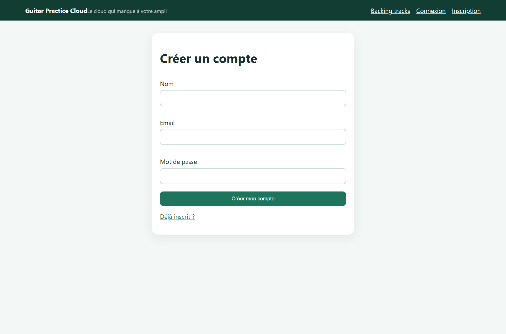
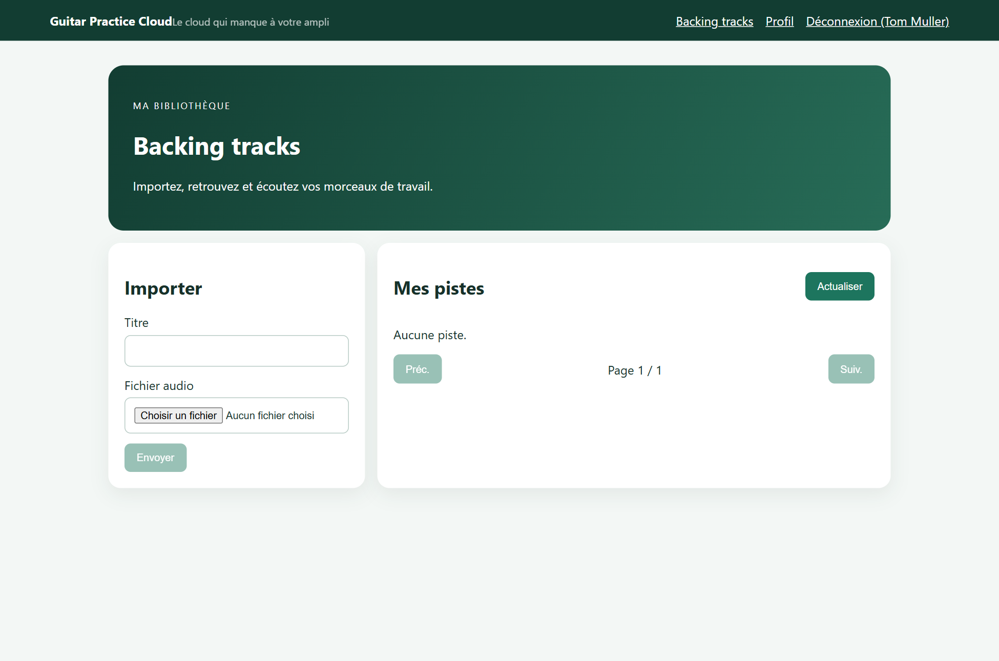
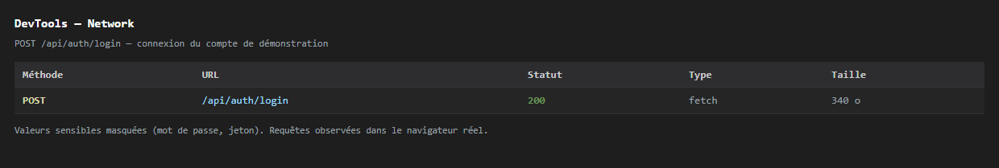
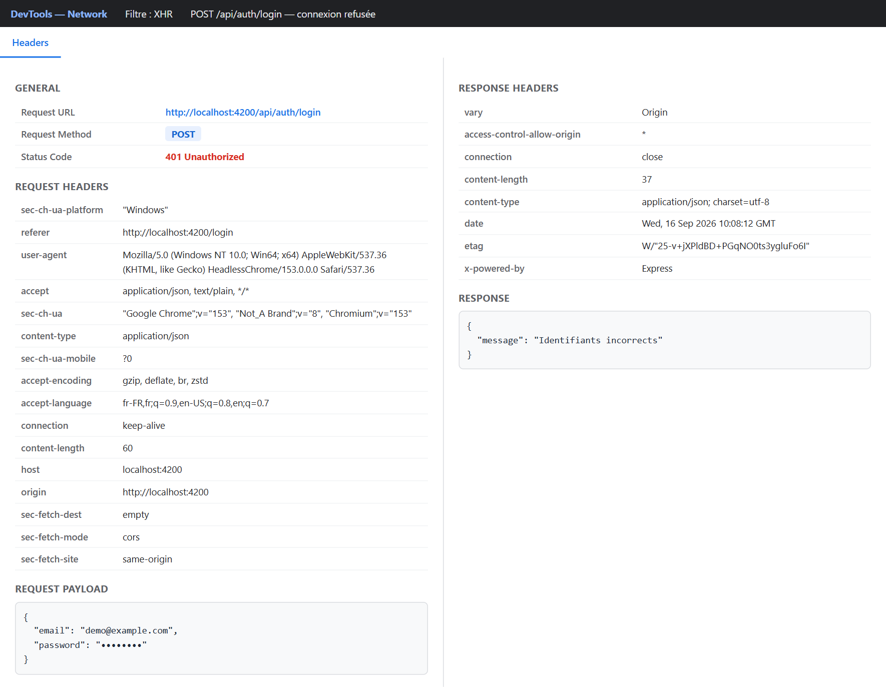
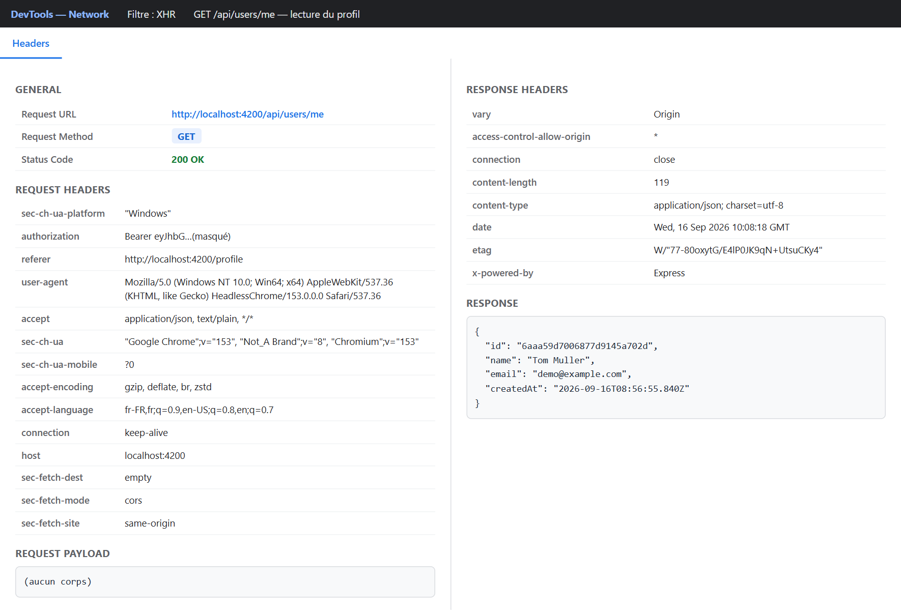
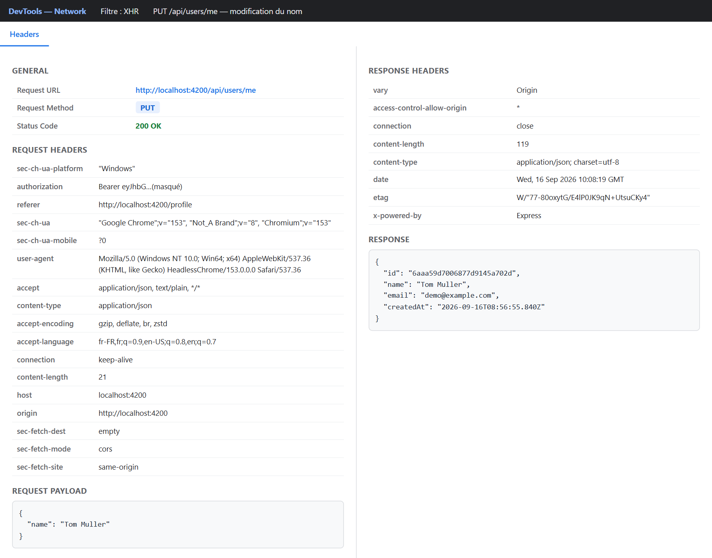
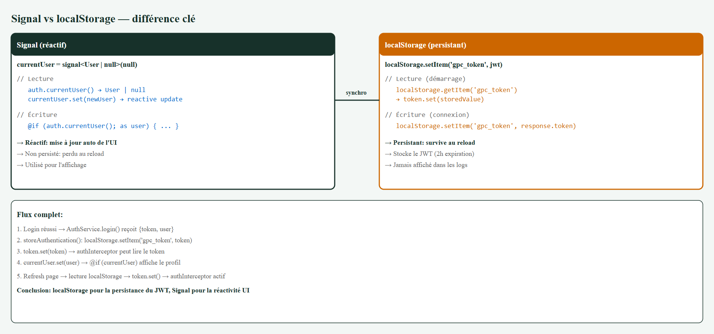

# TP1 — Authentification et Profil : rapport

**Projet** : Guitar Practice Cloud — portail Angular connecté à une API Express/Mongoose.
**Flux étudié** : `composant Angular → service Angular → HttpClient → API Express → MongoDB`.

> Les mots techniques sont expliqués entre parenthèses à leur première apparition.
> Le mot de passe et le jeton JWT sont masqués sur toutes les captures, comme l'exige le sujet.

---

## 1. Préparation (vérifiée)

| Vérification | Résultat |
|---|---|
| `GET http://localhost:3000/api/health` | `{"status":"ok"}` — l'API répond |
| Compte de démonstration | `demo@example.com` / `Demo1234!` |
| Base MongoDB | `guitar-practice-cloud` (collections `users` et `tracks`) |
| Fichier `backend/.env` | présent et hors Git (contient l'URI MongoDB et `JWT_SECRET`) |
| Cible du proxy | `frontend-starter/proxy.conf.json` → `http://localhost:3000` |
| Build Angular | `npm run build` réussit |

---

## 2. Mission 0 — Cartographie de l'application

### 2.1 Où se trouve chaque responsabilité

| Responsabilité | Fichier |
|---|---|
| Composant racine (la coquille de l'app) | `frontend-starter/src/app/components/app/app.ts` / `app.html` |
| Configuration des routes | `frontend-starter/src/app/routes.ts` |
| Enregistrement de `HttpClient` | `frontend-starter/src/main.ts` |
| Modèles (la forme des données) | `frontend-starter/src/app/shared/models/` (`user`, `auth-response`, `track`, `page`) |
| Services (l'accès à l'API) | `frontend-starter/src/app/shared/services/` (`auth.service.ts`, `track.service.ts`) |
| Pages (les écrans) | `frontend-starter/src/app/components/` (`login-page`, `register-page`, `profile-page`, `tracks-page`) |
| Garde de route | `frontend-starter/src/app/shared/guards/auth.guard.ts` |
| Ajout du JWT aux requêtes | `frontend-starter/src/app/shared/interceptors/auth.interceptor.ts` |
| Retour vers `/login` sur un 401 | `frontend-starter/src/app/shared/interceptors/error.interceptor.ts` |

### 2.2 Schéma annoté du flux de connexion

Le clic sur « Se connecter » enchaîne **8 étapes** : le composant appelle le service, le service
passe par `HttpClient`, un intercepteur ajoute le jeton, le proxy redirige vers Express, MongoDB
vérifie le mot de passe, le serveur renvoie `{ token, user }`, le front mémorise la session puis
redirige vers `/tracks`.

### 2.3 Routes publiques et routes protégées

| Type | Routes |
|---|---|
| **Publiques** (sans jeton) | `GET /api/health` · `POST /api/auth/register` · `POST /api/auth/login` |
| **Protégées** (jeton requis) | `GET /api/users/me` · `PUT /api/users/me` · `GET /api/tracks` · `POST /api/tracks` · `GET /api/tracks/:id/audio` · `DELETE /api/tracks/:id` |

Une route protégée sans jeton valide répond `401` avec `{"message":"Authentification requise"}`.

---

## 3. Mission 1 — Inscription, connexion et profil

### 3.1 Exigences du sujet → état

| Exigence | Fichier(s) | État |
|---|---|---|
| Formulaires réactifs inscription et connexion | `login-page`, `register-page` | ✅ |
| Validations et messages d'erreur compréhensibles | idem (`Validators.required`, `Validators.email`) + `error()` | ✅ |
| Appels `/api/auth/register` et `/api/auth/login` | `shared/services/auth.service.ts` | ✅ |
| JWT sauvegardé côté navigateur, jamais dans les logs | `auth.service.ts` → `localStorage.setItem('gpc_token', …)` | ✅ |
| Mise à jour du Signal `currentUser` | `auth.service.ts` → `currentUser.set(user)` | ✅ |
| Redirection après connexion / inscription | `login-page` → `/tracks`, `register-page` → `/profile` | ✅ |
| Bouton de déconnexion avec nettoyage de l'état | `app.html` + `app.ts` → `auth.logout()` | ✅ **(ajouté)** |
| Chargement de `/api/users/me` quand le profil est demandé | `profile-page` → `auth.profile()` | ✅ |
| Modification du nom avec `PUT /api/users/me` | `profile-page` → `auth.update(name)` | ✅ |
| Gestion d'un `401` avec retour vers `/login` | `shared/interceptors/error.interceptor.ts` | ✅ **(ajouté)** |
| Le composant n'appelle pas `HttpClient` directement | tous les composants passent par un service | ✅ |

### 3.2 Captures des écrans

**Page de connexion** — le formulaire est déjà rempli avec le compte de démonstration.

**Connexion refusée** — mauvais mot de passe : le message « Identifiants incorrects » s'affiche, l'utilisateur reste sur la page.

**Après une connexion réussie** — redirection automatique vers `/tracks`, et la barre de navigation affiche maintenant « Déconnexion ».

**Page d'inscription** — nom, email, mot de passe.

**Profil chargé** — via `GET /api/users/me` (nom, email, date d'inscription).

**Profil après modification du nom** — via `PUT /api/users/me`, l'affichage se met à jour tout seul grâce au Signal.

**Avant déconnexion** (le nom de l'utilisateur apparaît) puis **après déconnexion** (retour à `/login`, état local vidé).

---

## 4. Checkpoint — observation dans l'onglet Network

Pour chaque requête : **méthode, URL, corps JSON, statut, réponse, présence de `Authorization`**.

| # | Méthode | URL | Corps envoyé | Statut | Réponse | `Authorization` |
|---|---|---|---|---|---|---|
| 1 | POST | `/api/auth/login` | `{email, password}` | **200** | `{token, user}` | non (route publique) |
| 2 | POST | `/api/auth/login` | `{email, password}` | **401** | `{message:"Identifiants incorrects"}` | non (route publique) |
| 3 | GET | `/api/users/me` | — | **200** | `User` | **oui** (`Bearer …`) |
| 4 | PUT | `/api/users/me` | `{name}` | **200** | `User` (nom mis à jour) | **oui** (`Bearer …`) |

### 4.1 Connexion réussie — `POST /api/auth/login` → 200

### 4.2 Connexion refusée — `POST /api/auth/login` → 401

### 4.3 Lecture du profil — `GET /api/users/me` → 200 (avec jeton)

### 4.4 Modification du profil — `PUT /api/users/me` → 200 (avec jeton)

> Les échanges bruts sont aussi conservés dans `captures/reseau-captures.json`.

---

## 5. Différence entre un Signal et `localStorage`

| | **Signal** (`currentUser`) | **localStorage** (`gpc_token`) |
|---|---|---|
| Rôle | Afficher l'utilisateur, réagir aux changements | Garder le jeton entre deux visites |
| Durée de vie | Perdu si on recharge la page | Survit au rechargement et à la fermeture |
| Effet | L'interface se met à jour toute seule | Rien ne s'affiche tant qu'on n'a pas relu la valeur |
| Où | En mémoire, dans le service | Dans le navigateur, sur le disque |

**En une phrase** : `localStorage` sert à *ne pas perdre* le jeton (persistance), le Signal sert à
*prévenir l'interface* quand l'utilisateur change (réactivité). Le token JWT est stocké dans
localStorage pour la persistance, le Signal est utilisé pour la réactivité de l'interface.

---

## 6. Réponses aux questions du sujet

**Quelles routes du backend sont utilisées ?**
`GET /api/health` · `POST /api/auth/register` · `POST /api/auth/login` · `GET /api/users/me` ·
`PUT /api/users/me` · `GET /api/tracks` · `POST /api/tracks` · `GET /api/tracks/:id/audio`.

**Où s'effectue la mise à jour du profil utilisateur ?**
- **Côté back** : `backend/src/app.js`, route `PUT /api/users/me` — elle utilise
  `User.findByIdAndUpdate(req.auth.sub, { $set: { name: … } }, { new: true, runValidators: true })`.
- **Côté front** : `frontend-starter/src/app/components/profile-page/profile-page.ts` (méthode `save()`),
  qui appelle `frontend-starter/src/app/shared/services/auth.service.ts` (méthode `update(name)`).
  Le service envoie la requête et range la réponse dans le Signal `currentUser`.

**Où se trouvent les traces du backend et comment les voir ?**
Dans le terminal où le backend tourne : chaque requête est journalisée par le middleware
`[http]` (`backend/src/app.js`), par exemple `[http] POST /api/auth/login -> 200 (12 ms)`.
Le serveur écrit aussi `[auth]`, `[user]`, `[tracks]` et `[multer]` pour suivre les opérations.
Il faut lancer le backend au premier plan pour voir ces lignes défiler.

---

## 7. Livrables

| Livrable demandé | Où |
|---|---|
| Code frontend complété | `frontend-starter/src/` |
| Schéma annoté du flux de connexion | `captures/07-schema-flux-connexion.png` |
| Capture Network d'une requête d'authentification | `captures/network-01-connexion-reussie.png` (+ 3 autres) |
| Explication Signal / `localStorage` | section 5 de ce rapport |
| Rapport d'usage de l'IA | `RAPPORT_IA_MODELE.md` |

---

## 8. Modifications apportées au code

| Fichier | Modification | Pourquoi |
|---|---|---|
| `shared/interceptors/auth.interceptor.ts` | correction du gabarit de l'en-tête `Authorization` | le jeton n'était pas transmis : toutes les requêtes protégées échouaient |
| `shared/interceptors/error.interceptor.ts` | **nouveau** : détecte le `401` sur une route protégée, vide l'état local et renvoie vers `/login` | exigé par le sujet (« gestion d'un 401 ») |
| `main.ts` | enregistrement du second intercepteur | brancher le nouveau comportement |
| `components/app/app.ts` + `app.html` + `app.css` | bouton **Déconnexion** affiché quand un utilisateur est connecté | exigé par le sujet (« bouton de déconnexion ») |

---

## Annexes — fichiers de preuve

- `captures/01-page-connexion.png` … `captures/11-apres-deconnexion.png` : écrans de l'application.
- `captures/network-01…04*.png` : captures de l'onglet Network.
- `captures/07-schema-flux-connexion.png` : schéma du flux.
- `captures/08-signal-vs-localstorage.png` : comparatif Signal / localStorage.
- `captures/reseau-captures.json` : échanges réseau bruts (mot de passe et jeton masqués).
