# TP2 — Bibliothèque upload et lecture audio : rapport

**Projet** : Guitar Practice Cloud — portail Angular connecté à une API Express/Mongoose.
**Flux étudiés** : `composant → TrackService → HttpClient → API` puis `API → Blob → ObjectURL → <audio>`.

> Les missions 2 et 3 n'ont demandé aucune modification du backend. Les **bonus
> facultatifs** en revanche en ont apporté trois (filtre par titre, pagination
> Mongoose, image de couverture) : `API_CONTRACT.md` a donc été mis à jour, et la
> section 8 détaille ces ajouts.

---

## 1. Préparation (vérifiée)

| Vérification | Résultat |
|---|---|
| TP1 fonctionnel | connexion `demo@example.com` / `Demo1234!` → redirection `/tracks` ✅ |
| Cible du proxy | `frontend-starter/proxy.conf.json` → `http://localhost:3000` ✅ |
| `GET http://localhost:3000/api/health` | `{"status":"ok"}` ✅ |
| Fichiers de test | `fichiers-audio-de-test/song1.mp3` (3,4 Mo) et `song2.mp3` (6,1 Mo) ✅ |
| Aucune erreur console | 37 messages console, **0 erreur** pendant tout le parcours ✅ |

---

## 2. Mission 2 — Bibliothèque paginée

### 2.1 Le flux respecté

```text
TracksPageComponent.load()
  → TrackService.list(page, limit)
    → HttpClient.get('/api/tracks', { params: { page, limit } })
      → GET /api/tracks?page=2&limit=5
```

`TrackService.list()` construit explicitement ses paramètres :

```ts
let params = new HttpParams().set('page', page).set('limit', limit);

const search = q.trim();
if (search) params = params.set('q', search); // bonus « filtre par titre »

return this.http.get<Page<Track>>('/api/tracks', { params });
```

Aucune piste n'est téléchargée puis découpée dans Angular : **le serveur** fait le
`skip`/`limit` Mongoose et renvoie `items`, `page`, `limit`, `total`, `pages`.

### 2.2 État en Signals

| Signal | Rôle | Valeur observée en vrai |
|---|---|---|
| `tracks` | pistes de la page courante | 5 puis 5 |
| `page` | page affichée (base 1, comme l'API) | 1 puis 2 |
| `pages` | nombre total de pages calculé par le serveur | 2 |
| `total` | nombre total de pistes, donné au paginator | 10 |
| `loading` | requête en cours | `true` pendant l'attente |
| `error` | message d'erreur lisible | `null` en marche nominale |

`loading` est affiché avec `@if`, la liste avec `@for` et l'état vide avec `@empty`.

### 2.3 Pagination : deux contrôles, une seule source de vérité

| Exigence du sujet | Où | État |
|---|---|---|
| Boutons « Précédent » / « Suivant » désactivés aux bornes | `tracks-page.html` (`.pager`) + `go()` | ✅ |
| Une requête HTTP à chaque changement de page | `go()` / `onPage()` → `load()` | ✅ |
| AVANCÉ — Paginator Angular Material | `<mat-paginator>` (`MatPaginatorModule`) | ✅ |
| AVANCÉ — Pagination Mongoose (`aggregate-paginate-v2`) | plugin installé et branché sur `GET /api/tracks` (bonus, section 8.2) | ✅ |

Les deux contrôles (`Précédent/Suivant` et le paginator Material) pilotent **les mêmes
signaux** : le paginator fournit `[length]="total()"`, `[pageIndex]="page() - 1"` et
`(page)="onPage($event)"`, en version Material (thème `azure-blue` importé dans
`styles.css`, accents réalignés sur la charte verte du projet).

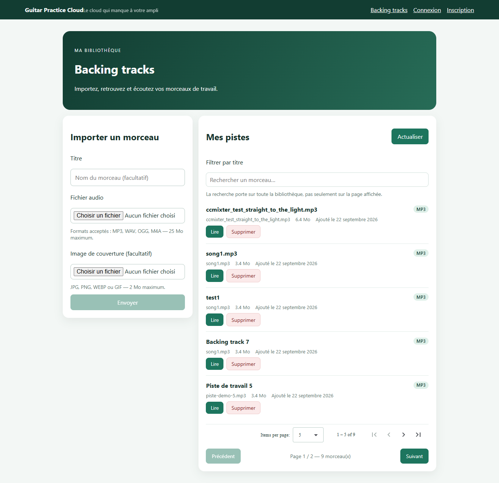

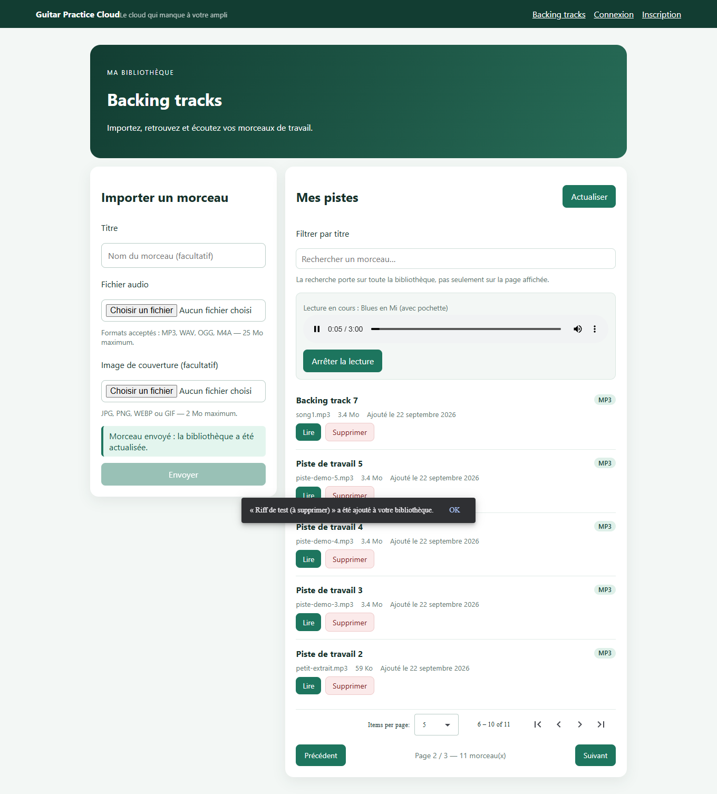

La page 2 est bien demandée au serveur, avec `page=2` dans l'URL :

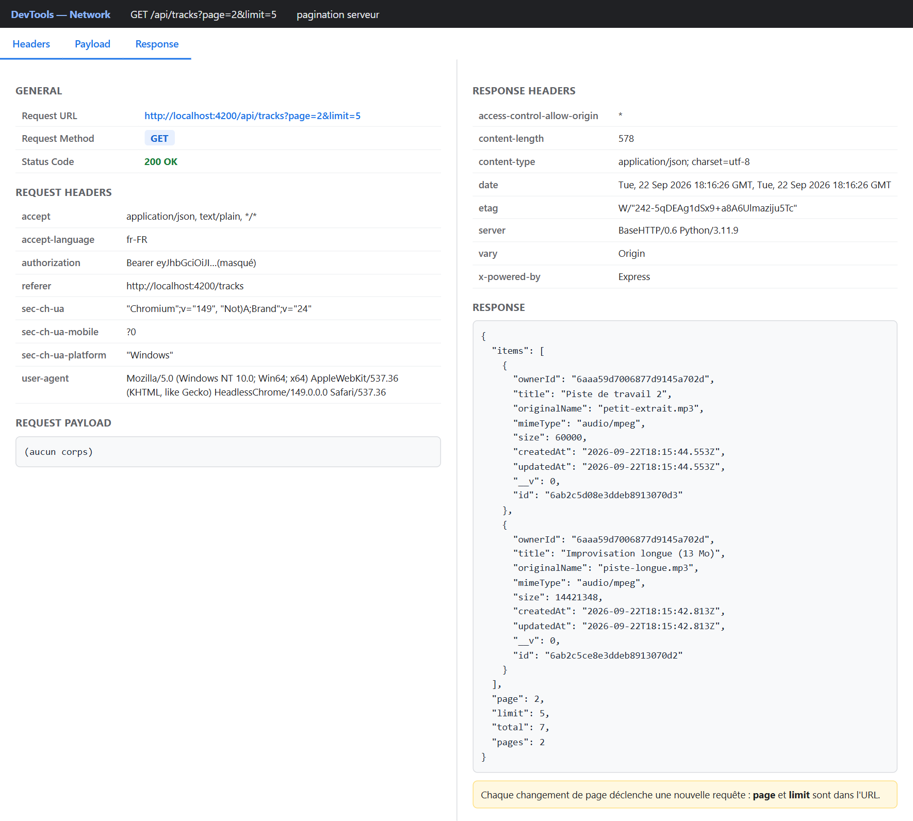

---

## 3. Mission 3 — Analyse de l'upload et de la lecture existants

### 3.1 Où se trouve chaque étape du flux

| Étape | Fichier et méthode |
|---|---|
| Choix du fichier | `tracks-page.html` (`<input #fileInput type="file">`) → `tracks-page.ts` `choose(event)` |
| Construction du `FormData` | `shared/services/track.service.ts` → `upload(file, title)` (`append('audio', …)`, `append('title', …)`) |
| Appel HTTP d'upload | `track.service.ts` → `HttpClient.post('/api/tracks', body, { observe: 'events', reportProgress: true })` |
| Récupération du `Blob` | `track.service.ts` → `audio(id)` avec `responseType: 'blob'` |
| Création de l'`ObjectURL` | `tracks-page.ts` → `play(track)` : `URL.createObjectURL(blob)` |
| Affectation au lecteur `<audio>` | `tracks-page.html` : `[src]="audioUrl()"` |
| Révocation de l'ancienne URL | `tracks-page.ts` → `releaseAudioUrl()`, appelée avant chaque nouvelle lecture, à l'arrêt, et dans `DestroyRef.onDestroy()` |

### 3.2 L'intercepteur et le JWT

L'en-tête est ajouté par `shared/interceptors/auth.interceptor.ts`, enregistré dans
`main.ts` (`provideHttpClient(withInterceptors([authInterceptor, errorInterceptor]))`).
On le voit dans l'onglet Network : la requête audio porte bien
`Authorization: Bearer …`.

**Pourquoi une URL placée directement dans `src` ne reçoit pas ce header ?**
Parce qu'un `<audio src="/api/tracks/…/audio">` est chargé par le *moteur média* du
navigateur, pas par `HttpClient`. Les intercepteurs Angular ne s'appliquent qu'aux
requêtes qui traversent `HttpClient` ; le chargement média est une requête HTTP nue,
sans possibilité d'y ajouter un en-tête personnalisé. L'API répondrait donc `401`.
C'est exactement pourquoi on télécharge d'abord le fichier en `Blob` via `HttpClient`
(avec le jeton), puis qu'on donne au lecteur une URL `blob:` locale.

### 3.3 Contrôles côté backend (inchangés) et validation côté frontend

| Contrôle backend | Fichier | Repris côté frontend |
|---|---|---|
| champ multipart `audio` obligatoire | `backend/src/app.js`, `upload.single("audio")` + `if (!req.file)` → `400` | `selectedFile()` : le bouton reste désactivé sans fichier |
| champ texte `title` | `req.body.title \|\| req.file.originalname` | `title.value.trim() \|\| file.name` |
| types MIME acceptés | `const allowed = new Set([...])` (`audio/mpeg`, `audio/wav`, `audio/x-wav`, `audio/ogg`, `audio/mp4`, `audio/x-m4a`) | `validateAudioFile()` dans `shared/utils/audio-file.ts` |
| 25 Mo maximum | `limits: { fileSize: MAX_FILE_SIZE }` | `MAX_AUDIO_SIZE = 25 * 1024 * 1024` |
| champ facultatif `cover` (bonus) : 4 types d'image, 2 Mo | `allowedImages`, `MAX_COVER_SIZE` dans `app.js` | `validateCoverFile()` dans `shared/utils/cover-file.ts` |

**Pourquoi la validation frontend ne remplace jamais celle du backend :**
la validation locale sert le confort (retour immédiat, pas d'envoi inutile de 25 Mo).
Mais elle s'exécute dans un environnement que l'utilisateur contrôle : il peut
désactiver JavaScript, modifier le code dans les DevTools ou appeler l'API avec
`curl`. Seuls les contrôles du serveur (Multer `fileFilter`, `limits`, middleware
d'auth) sont incontournables — le frontend propose, le backend décide.

Ce double niveau a été vérifié : un fichier `notes.txt` est refusé immédiatement
par l'interface (aucune requête réseau émise), et un type refusé qui arriverait
malgré tout au serveur reçoit `400 {"message":"Format audio non accepté"}`
(test de contrat backend, voir `RAPPORT_TP3.md`).

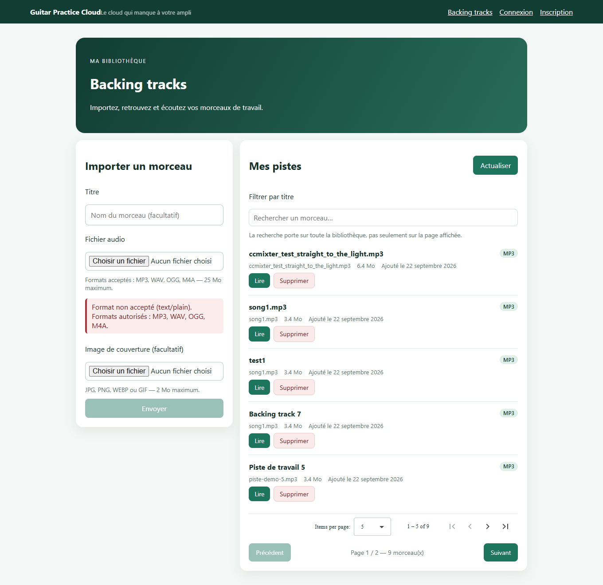

### 3.4 États d'interface pendant l'envoi

| Élément demandé | Implémentation | Preuve |
|---|---|---|
| état de chargement | `uploadPhase = 'uploading'` + `<mat-progress-bar>` + « Envoi en cours… X % » | capture ci-dessous |
| bouton désactivé / anti double envoi | `uploading()` désactive `input`, `select` et bouton ; `upload()` sort immédiatement si `uploading()` | test unitaire |
| erreurs du serveur affichées | `describeHttpError()` lit `{ message }` de la réponse (`400` format, `413` taille…) | test unitaire (400) |
| message de succès | bandeau « Morceau envoyé… » + SnackBar Material | capture ci-dessous |
| formulaire vidé + retour page 1 | `resetForm()` puis `page.set(1)` + `load()` | test unitaire |

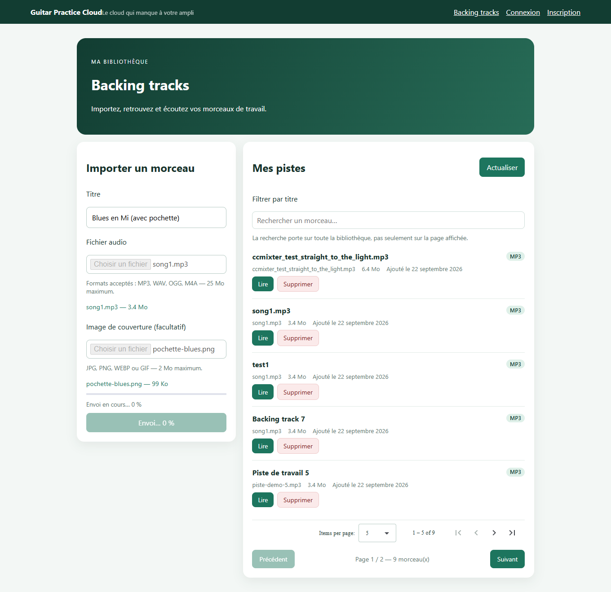

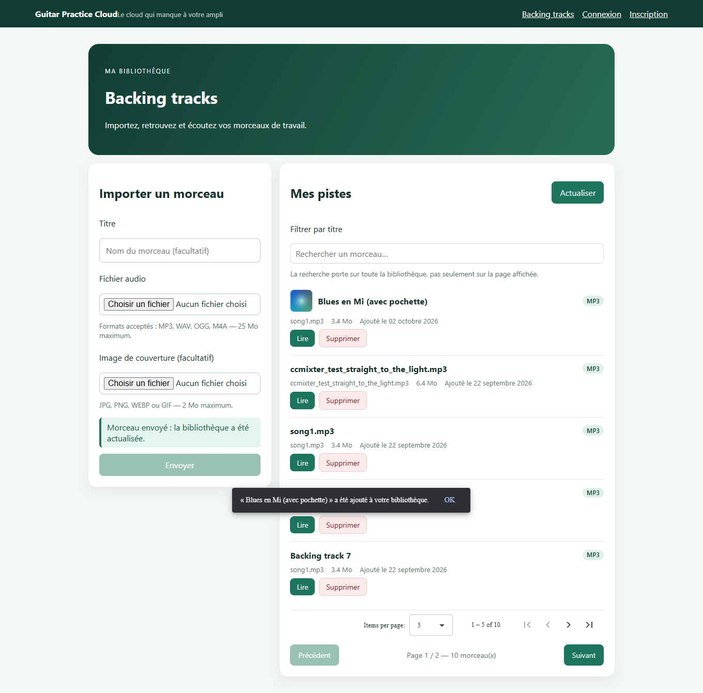

> **Mesure honnête sur la progression.** En boucle locale, Chromium confie tout le
> corps de la requête à sa couche réseau avant d'annoncer le moindre octet : la
> valeur observée reste donc `0 %` jusqu'à la fin, y compris sur un fichier de
> 13,7 Mo volontairement ralenti (~660 ko/s via un proxy local). La capture montre
> bien l'état « envoi en cours » (bouton désactivé, barre, texte `Envoi… 0 %`).
> Le calcul du pourcentage est en revanche vérifié par un test unitaire qui injecte
> un événement `UploadProgress` `loaded = 50 / total = 100` et attend `50 %`.
> Sur un réseau réel (4G, ADSL), les événements arrivent progressivement et la
> même barre avance normalement.

### 3.5 Lecture : cartes, morceau en cours, erreurs, révocation

Les morceaux sont présentés en cartes responsives et accessibles : titre, nom
original, format (`audioFormatLabel`), taille (`formatBytes`), date d'ajout
(`formatDate`) et deux actions (`aria-label` explicite, boutons natifs focusables).

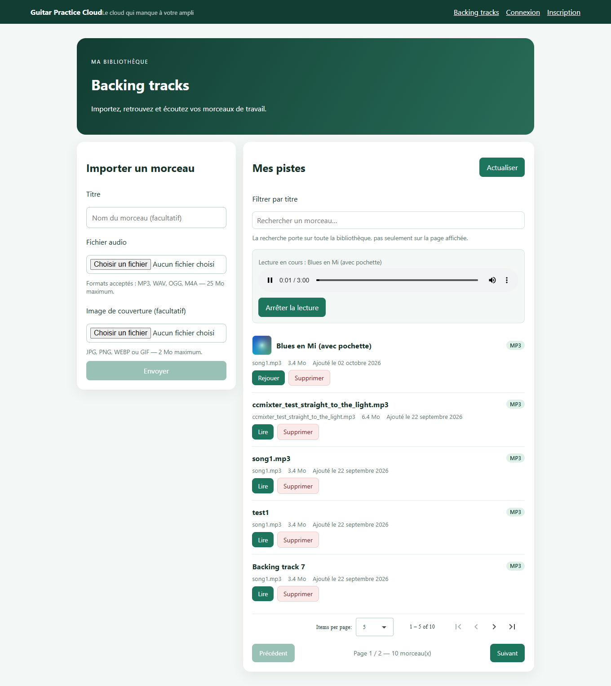

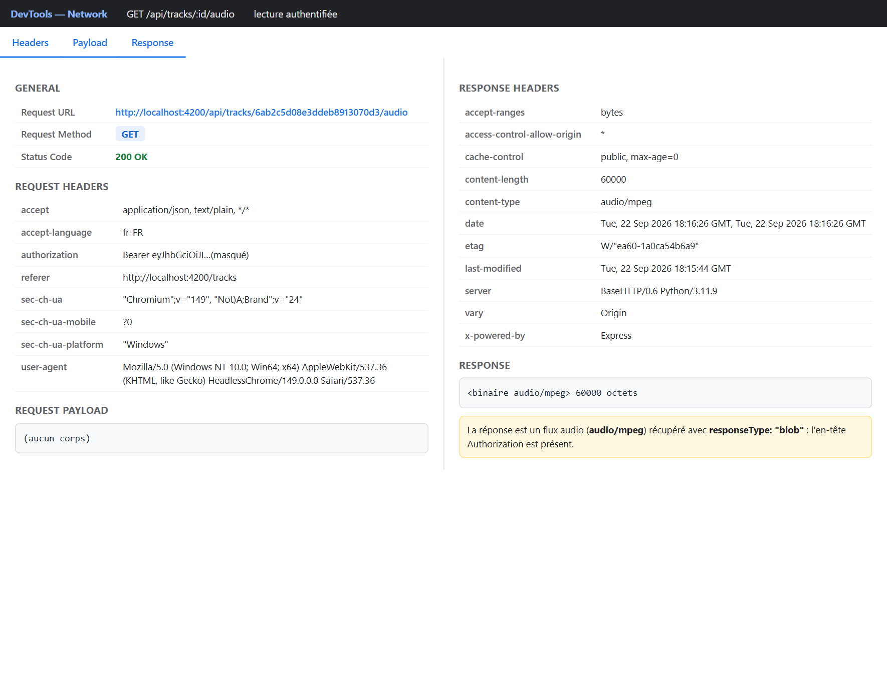

- **morceau en cours** : `playingId` / `playingTitle` affichent « Lecture en cours : … » ;
- **erreur audio compréhensible** : erreur HTTP (`describeHttpError`), Blob vide, ou
  échec du décodeur via `(error)="audioFailed()"` sur la balise `<audio>` ;
- **révocation finale** : `DestroyRef.onDestroy(() => this.releaseAudioUrl())`, donc
  l'`ObjectURL` est libérée quand on quitte la page / déconnecte.

---

## 4. Questions — mémoire, buffering et streaming

**1. Le backend envoie-t-il le fichier entier en mémoire ou progressivement depuis le disque ?**
Progressivement. La route `GET /api/tracks/:id/audio` termine par
`res.sendFile(audioPath, callback)` : Express ouvre un flux de lecture sur le
fichier et le transmet par morceaux au socket. Le serveur ne charge pas les 25 Mo
en mémoire. MongoDB ne contient que les métadonnées ; les octets restent sur le
disque (`backend/data/uploads`).

**2. Avec `HttpClient` et `responseType: "blob"`, quand le composant reçoit-il le fichier ?**
À la **fin** du téléchargement. Le `Blob` est le résultat complet de la réponse :
`HttpClient` accumule les morceaux reçus, puis émet une seule valeur finale. Le
composant n'a donc pas accès aux octets au fur et à mesure — pas de lecture
progressive côté client, contrairement au serveur qui, lui, envoie en flux.
C'est le prix de la simplicité : le fichier doit tenir en mémoire du navigateur.

**3. Avec 100 morceaux dans la bibliothèque, les 100 fichiers sont-ils chargés dès l'affichage ?**
Non, et c'est démontrable dans le code : `load()` appelle `list()`, qui ne renvoie
que des **métadonnées JSON** (`title`, `originalName`, `mimeType`, `size`,
`createdAt`) — aucune route audio n'est appelée. `tracks()` ne contient en plus
que les 5 pistes de la page courante (pagination serveur) et une seule
`ObjectURL` vit à la fois : la précédente est révoquée avant d'en créer une
nouvelle. Seul le morceau explicitement lu est téléchargé.

**4. Quelle différence avec 100 éléments `<audio>` utilisant directement une URL HTTP ?**
Trois différences majeures :
- le navigateur gère lui-même le chargement : selon le contexte il peut lancer
  jusqu'à 100 requêtes (souvent limitées à ~6 en parallèle), et plusieurs sont
  préchargés puis gardés en mémoire via le buffering média dès que la lecture
  ou le préchargement démarre ;
- aucune de ces requêtes ne porte `Authorization: Bearer …` (une URL dans `src`
  n'est pas interceptée), donc les réponses seraient `401` : l'API serait vide ou
  les lecteurs cassés ;
- supprimer une piste devient impossible en toute sécurité : le navigateur garde
  son propre cache média indépendant de l'état Angular.

**5. Pourquoi l'URL créée par `URL.createObjectURL` doit-elle être révoquée ?**
Parce que l'URL `blob:` maintient une **référence vivante** sur le `Blob` : tant
qu'elle n'est pas révoquée, le navigateur ne peut pas libérer les octets
correspondants, même si plus rien ne les utilise. Sur une page où l'on enchaîne
les lectures (ou 100 pistes), cela se traduit par une consommation mémoire
croissante jusqu'au rechargement de l'onglet. On révoque donc systématiquement
l'ancienne URL avant d'en créer une nouvelle, et une dernière fois à la
destruction du composant.

---

## 5. Checkpoint Network

| Point à vérifier | Constat |
|---|---|
| chaque changement de page modifie `page` | `GET /api/tracks?page=1&limit=5` puis `?page=2&limit=5` ✅ |
| l'upload est bien multipart avec `audio` et `title` | champs réellement lus dans le corps : `audio = [File] "song2.mp3" (audio/mpeg)`, `title = "<texte>"` ✅ |
| la réponse de lecture est un flux audio | `GET /api/tracks/:id/audio` → `200`, `Content-Type: audio/mpeg` ✅ |
| une erreur `400` pour un fichier invalide | refus immédiat côté frontend, et `400 {"message":"Format audio non accepté"}` vérifié côté API ✅ |
| une piste ne peut être lue que par son propriétaire | `GET /api/tracks/:id/audio` d'un intrus → `404` (test d'intégration) ✅ |
| le filtre part bien au serveur | `GET /api/tracks?page=1&limit=5&q=blues` → `200`, 1 piste sur 10 ✅ |
| l'upload porte aussi la couverture | `POST /api/tracks` → `201`, réponse avec `hasCover: true` ✅ |
| la couverture est servie derrière le JWT | `GET /api/tracks/:id/cover` → `200`, `Content-Type: image/png`, 99,3 Ko ✅ |

Les échanges bruts sont conservés dans `captures/reseau-tp2-tp3.json`
(22 requêtes) et `captures/reseau-multipart.json` (corps multipart).

---

## 6. Livrables TP2

| Livrable | Où |
|---|---|
| code frontend complété | `frontend-starter/src/` (`tracks-page`, `track.service.ts`, `shared/utils/`) |
| cards de bibliothèque lisibles | capture `12-tp2-bibliotheque-page1.png` |
| capture Network de la pagination ou de l'upload | `network-05-pagination-page2.png`, `network-06-upload-multipart.png` |
| capture de la lecture audio authentifiée | `15-tp2-lecture-audio.png` + `network-07-lecture-audio.png` |
| explication du choix `Blob` / `ObjectURL` | sections 3.2 et 4 |
| réponses aux questions mémoire / buffering / streaming | section 4 |
| bonus facultatifs | section 8 : filtre par titre, pagination Mongoose, image de couverture |

---

## 7. Fichiers modifiés au TP2

| Fichier | Modification |
|---|---|
| `shared/services/track.service.ts` | `list()` avec `HttpParams`, `upload()` en `observe: 'events'`, `audio()` en `Blob`, `remove()` |
| `components/tracks-page/tracks-page.ts` | état complet en Signals (liste, page, pages, total, loading, error, upload, lecture) |
| `components/tracks-page/tracks-page.html` | cartes, états d'upload, lecteur, paginator Material, messages `role="alert"` |
| `components/tracks-page/tracks-page.css` | mise en page des cartes, du lecteur et de la pagination |
| `shared/utils/format.ts` **(nouveau)** | `formatBytes`, `formatDate`, `audioFormatLabel`, `formatDuration` |
| `shared/utils/audio-file.ts` **(nouveau)** | `validateAudioFile`, constantes alignées sur Multer |
| `shared/utils/http-error.ts` **(nouveau)** | `describeHttpError` : transformer une erreur HTTP en message utilisateur |
| `src/styles.css` | thème Material + styles de SnackBar |
| `frontend-starter/angular.json`, `package.json` | Material et jsdom, configuration du runner de tests |
| `shared/models/track.model.ts` | ajout de `hasCover` et `coverMimeType` (bonus) |
| `shared/models/page.model.ts` | ajout des métadonnées `aggregate-paginate-v2` (bonus) |
| `shared/utils/cover-file.ts` **(nouveau)** | `validateCoverFile`, constantes alignées sur Multer (bonus) |
| `backend/src/models/Track.js` | plugin `aggregate-paginate-v2`, champs `coverStoredName` (`select: false`), `coverMimeType`, `coverSize`, `toPublic()` |
| `backend/src/app.js` | filtre `q` échappé, `upload.fields([audio, cover])`, helper `removeFiles()`, route `GET /tracks/:id/cover`, `aggregatePaginate` |
| `backend/package.json` | `mongoose-aggregate-paginate-v2@1.1.5` |
| `API_CONTRACT.md` | paramètre `q`, champ `cover`, route cover, métadonnées de pagination |
---

## 8. Bonus facultatifs réalisés

Le sujet propose trois options facultatives. Les trois ont été retenues, ce qui a
demandé d'étendre le backend : le contrat HTTP a donc été mis à jour dans le même
temps (`API_CONTRACT.md`), comme l'exige `frontend-starter/AGENTS.md`.

### 8.1 Filtre par titre (paramètre `q`)

**Côté serveur** (`backend/src/app.js`) :

```js
const q = String(req.query.q ?? "").trim();
const filter = { ownerId: new mongoose.Types.ObjectId(req.auth.sub) };

if (q) {
  filter.title = { $regex: q.replace(/[.*+?^${}()|[\]\\]/g, "\\$&"), $options: "i" };
}
```

Deux points importants :

- le terme est **échappé** avant d'être utilisé comme expression régulière. Sans
  cela, une saisie comme `.*` correspondrait à toutes les pistes et une parenthèse
  ferait échouer la requête. L'utilisateur doit chercher un texte, pas écrire une
  regex ;
- `$options: "i"` rend la recherche insensible à la casse.

**Côté client**, `tracks-page.ts` garde un `FormControl` dédié, temporisé à 300 ms
(`debounceTime`) et dédoublonné (`distinctUntilChanged`) pour ne pas envoyer une
requête à chaque frappe. Chaque recherche **repart de la page 1** : sans cela, on
resterait sur une page qui peut ne plus exister dans le résultat filtré.

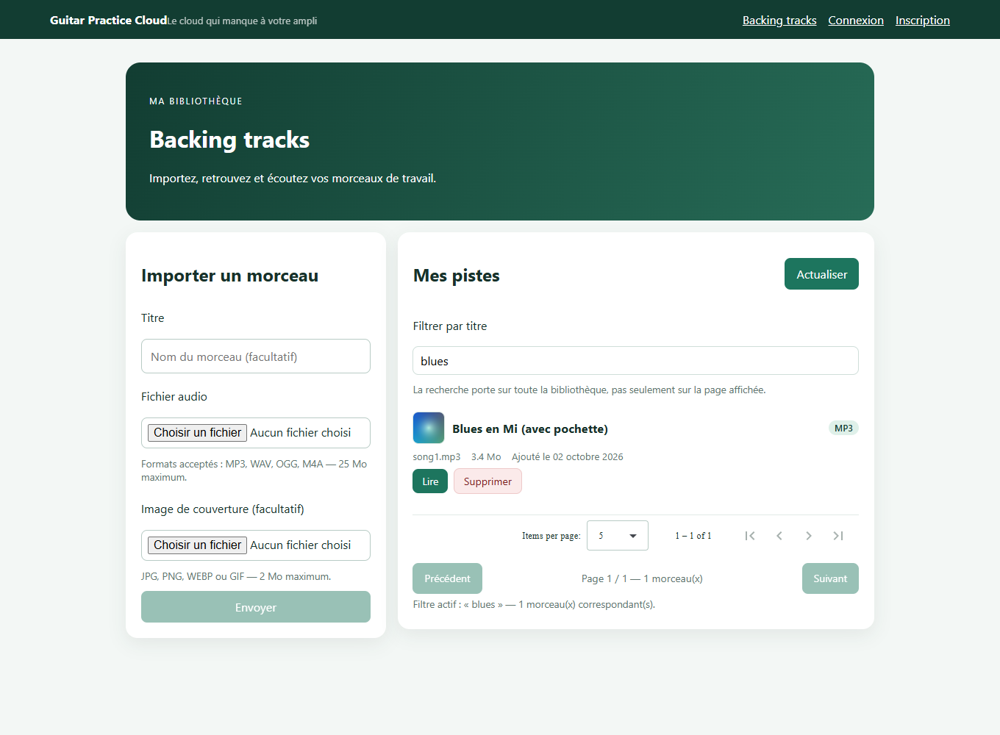

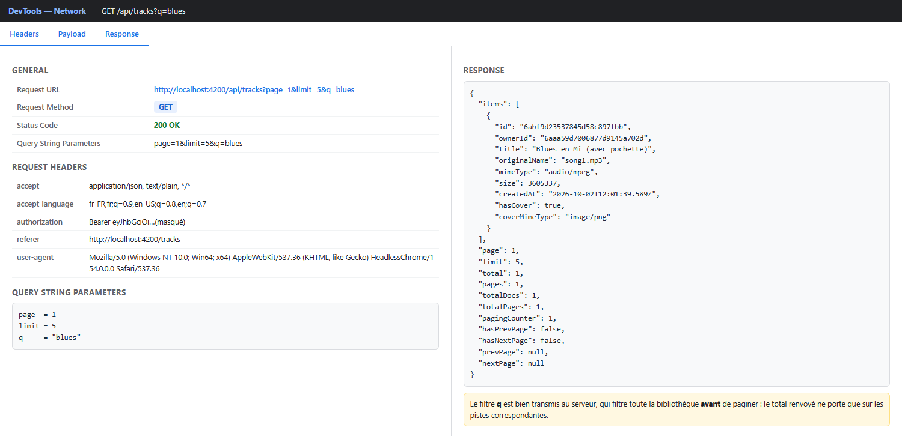

La requête observée est bien `GET /api/tracks?page=1&limit=5&q=blues` → `200`, et le
serveur ne renvoie qu'une piste sur 10.

### 8.2 Pagination Mongoose (`aggregate-paginate-v2`)

Le plugin est branché sur le schéma :

```js
// backend/src/models/Track.js
import aggregatePaginate from "mongoose-aggregate-paginate-v2";
schema.plugin(aggregatePaginate);
```

et la route pagine une agrégation plutôt qu'un `find()` :

```js
const result = await Track.aggregatePaginate(Track.aggregate(pipeline), { page, limit });
```

`pipeline` enchaîne le `$match` (propriétaire + filtre `q`), un `$sort` par date
décroissante, un `$addFields` qui calcule `hasCover`, puis un `$project` qui retire
les champs internes (`storedName`, `coverStoredName`, `__v`, `updatedAt`).

**Piège rencontré, et corrigé.** Une agrégation ne convertit pas les types comme le
fait `find()` : `req.auth.sub` est une **chaîne**, alors que `ownerId` est un
`ObjectId` en base. Le `$match` ne renvoyait donc aucune piste et la bibliothèque
apparaissait vide. La correction valide l'identifiant puis le convertit
explicitement :

```js
if (!mongoose.Types.ObjectId.isValid(req.auth.sub)) {
  return res.status(401).json({ message: "Jeton invalide" });
}
const filter = { ownerId: new mongoose.Types.ObjectId(req.auth.sub) };
```

Le plugin ajoute à la réponse `totalDocs`, `totalPages`, `pagingCounter`,
`hasPrevPage`, `hasNextPage`, `prevPage` et `nextPage`. Le composant s'en sert
directement pour désactiver « Précédent » / « Suivant », au lieu de recalculer les
bornes à partir de `page` et `pages`.

### 8.3 Image de couverture

Le champ `cover` est accepté par le même `upload.fields([...])` que l'audio :

```js
const allowedImages = new Set(["image/jpeg", "image/png", "image/webp", "image/gif"]);
const MAX_COVER_SIZE = 2 * 1024 * 1024;
```

L'image est stockée sur disque comme l'audio, dans `backend/data/uploads`. Le nom du
fichier (`coverStoredName`) est en `select: false` : il ne sort **jamais** de la base.
Le client ne reçoit que `hasCover` et `coverMimeType`.

La restitution passe par une route dédiée et protégée, `GET /api/tracks/:id/cover`,
qui applique la même règle de propriété que l'audio (un autre utilisateur reçoit
`404`). Côté Angular, l'image est récupérée en `Blob` — même raison que pour l'audio :
une balise `` ne transmettrait pas l'en-tête `Authorization`, donc
elle recevrait un `401`.

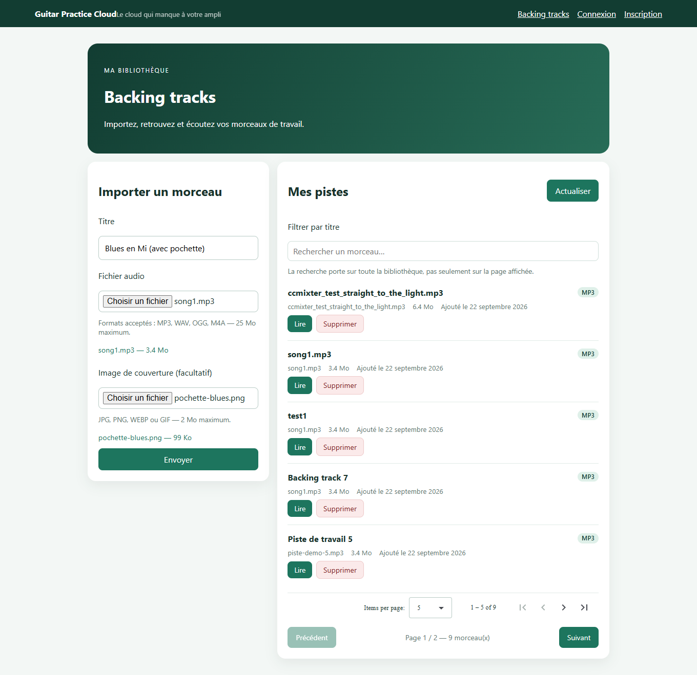

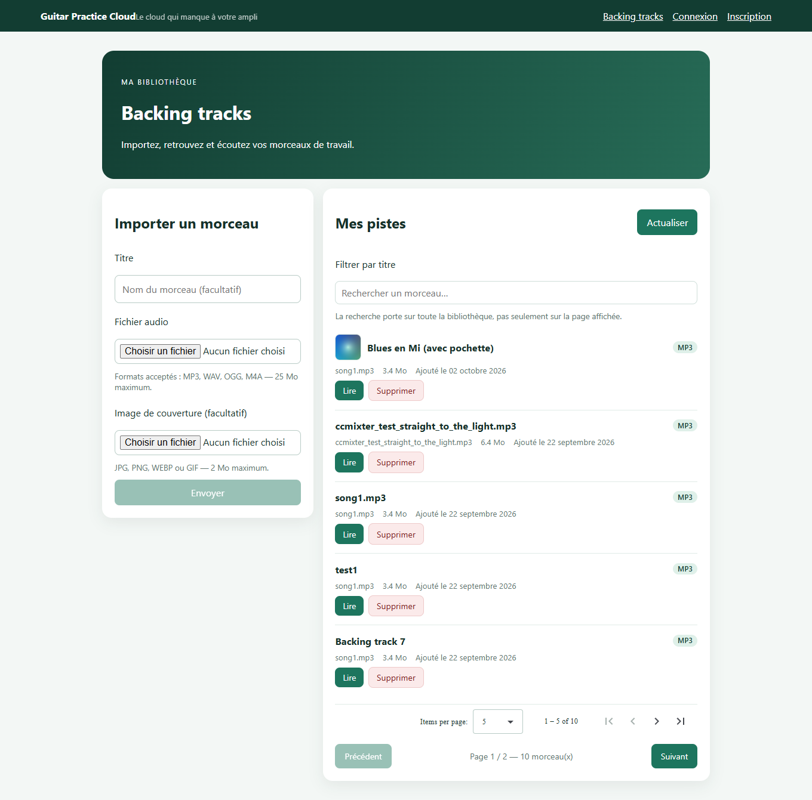

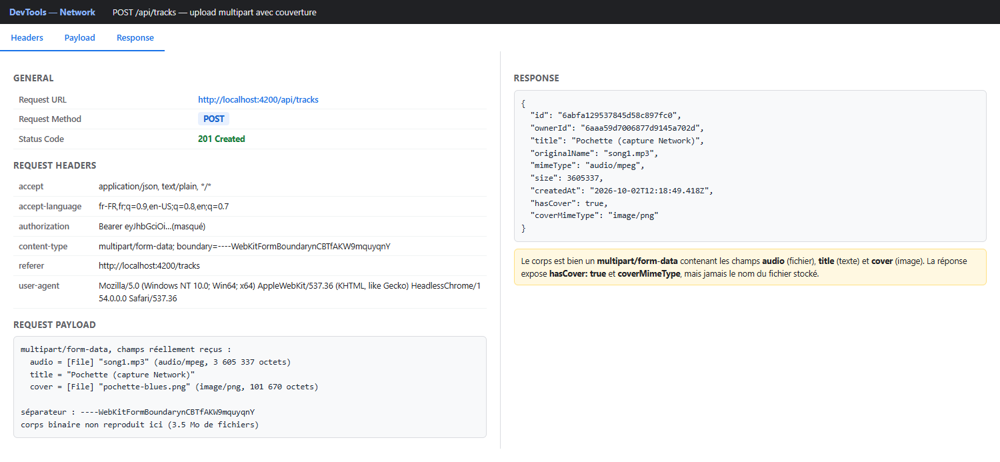

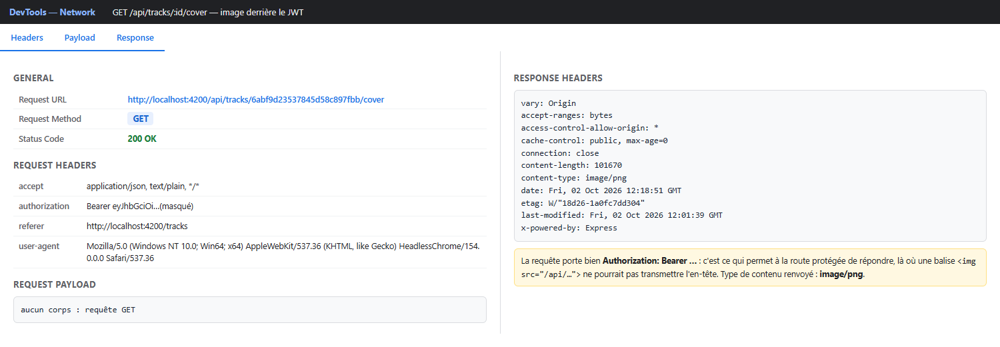

### 8.4 Effet des bonus sur les tests

| Suite | Avant | Après |
|---|---|---|
| Frontend (`npm test`) | 35 tests | **45 tests**, tous passés en ~3,9 s |
| Backend (`npm run test:db`) | 12 tests (9 passés, 3 ignorés) | **16 tests**, tous passés |

Les nouveaux tests couvrent : l'envoi de `q` (présent, absent, espaces retirés),
l'ajout du champ `cover` au `FormData`, la lecture de la couverture en `Blob`, le
refus d'une image invalide sans requête réseau, la révocation de l'URL de vignette,
les bornes de pagination venues du serveur, l'échappement de la regex (`q=.*` → 0
résultat), les métadonnées du plugin, et le cycle complet d'une couverture
(envoi → lecture → `404` pour un intrus → suppression).
