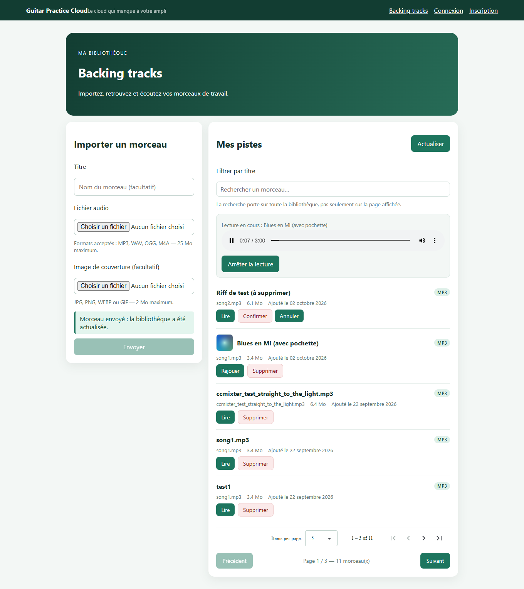
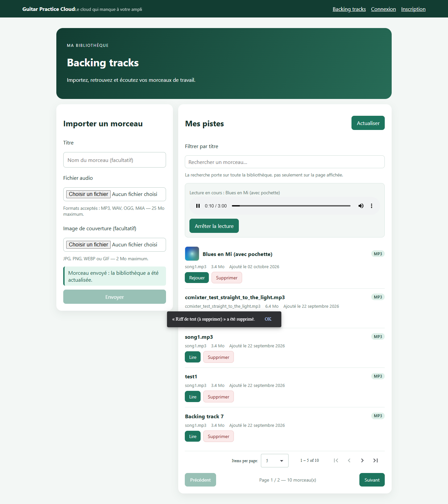
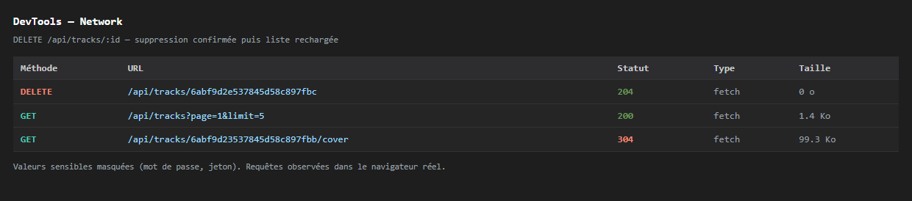

# TP3 — Fiabilisation et enrichissement du frontend : rapport

**Objectif** : ajouter la suppression d'une piste, la progression d'upload et une
suite de tests, **sans casser** l'authentification (TP1) ni la bibliothèque (TP2).

---

## 1. Déroulement réellement suivi

| Temps | Activité | Production |
|---|---|---|
| 0:00–0:15 | relecture du code et de l'état des tests | `frontend-starter` sans suite de tests, backend avec 2 tests |
| 0:15–0:50 | suppression d'une piste | action, confirmation, états, SnackBar |
| 0:50–1:20 | progression d'upload | pourcentage, états, anti double envoi |
| 1:20–1:50 | tests automatisés | 6 fichiers frontend (35 tests) + extension backend (12 tests) |
| après la séance | bonus facultatifs du TP2 (filtre, pagination Mongoose, couverture) | 10 tests frontend et 4 tests backend ajoutés : 45 et 16 au total |
| 1:50–2:00 | build, Network, restitution | `npm run build`, captures, ce rapport |

---

## 2. Mission 5 — Suppression d'une piste

### 2.1 Chaîne d'appel

```text
card de piste → confirmDelete(track) → TrackService.remove(id)
              → HttpClient.delete('/api/tracks/:id') → 204 No Content
              → refreshAfterDelete() → load() → GET /api/tracks
```

Le composant **n'appelle jamais `HttpClient`** : il passe par `TrackService.remove()`.

### 2.2 Exigences et implémentation

| Exigence du sujet | Implémentation |
|---|---|
| action « Supprimer » dans chaque card | bouton `.danger` dans `.track-actions`, `aria-label` « Supprimer *titre* » |
| confirmation avant suppression | état `pendingDeleteId` : le bouton devient deux boutons « Confirmer » / « Annuler » (`role="group"`) |
| état de suppression, anti double clic | `deletingId` désactive les boutons de la carte et `confirmDelete()` sort si une suppression est déjà en cours |
| message de succès ou d'erreur | `MatSnackBar` via `notify()` / `notifyError()` |
| mise à jour du contenu de la page | `refreshAfterDelete()` : recharge la page ; si la piste supprimée était la dernière de la page, recule d'une page |
| piste inexistante ou non possédée | un `404` déclenche « *titre* n'existe plus : la liste a été actualisée. » puis rechargement |







### 2.3 Pourquoi le guard Angular et l'interface ne suffisent pas à sécuriser la suppression

- `authGuard` ne protège **que la navigation** : il décide d'afficher ou non une
  route. Il ne s'exécute pas quand on clique « Supprimer », et il ne sait rien de
  la propriété de la piste.
- L'interface (bouton absent, confirmation, `deletingId`) n'est qu'une convention
  visuelle : on peut appeler l'API directement avec `curl`, ou modifier le DOM.
- Le contrôle réel est serveur : `auth` vérifie la signature et l'expiration du
  JWT, puis la requête Mongoose filtre **simultanément** sur l'identifiant et sur
  le propriétaire :

```js
const track = await Track.findOneAndDelete({
  _id: req.params.id,
  ownerId: req.auth.sub,   // <- un intrus ne peut pas supprimer la piste d'autrui
});
if (!track) return res.status(404).json({ message: "Piste inconnue" });
```

Un intrus reçoit donc `404` (et non `403`) : la réponse ne révèle même pas
l'existence de la piste. Ce comportement est vérifié par un test d'intégration
(voir § 4.2).

---

## 3. Mission 6 — Progression de l'upload

### 3.1 Les quatre états, explicites

```ts
export type UploadPhase = 'idle' | 'uploading' | 'success' | 'error';
```

| État | Ce que voit l'utilisateur |
|---|---|
| `idle` | aucune bande, bouton « Envoyer » actif dès qu'un fichier est choisi |
| `uploading` | `<mat-progress-bar>` + « Envoi en cours… X % », contrôles désactivés, bouton « Envoi… X % » |
| `success` | bandeau « Morceau envoyé : la bibliothèque a été actualisée. » + SnackBar, formulaire vidé, retour page 1 |
| `error` | message lisible issu de la réponse du serveur (ex. « Format non accepté ») |

Un état unique (`uploadPhase`) évite les combinaisons incohérentes qu'auraient
produites plusieurs booléens (`isLoading && !hasError && …`).

### 3.2 Comment le pourcentage est calculé

```ts
this.service.upload(file, title).subscribe((event) => {
  switch (event.type) {
    case HttpEventType.UploadProgress: {
      const total = event.total || file.size;
      this.uploadPercent.set(Math.min(100, Math.round((event.loaded / total) * 100)));
      break;
    }
    case HttpEventType.Response: /* succès */ break;
  }
});
```

Le service demande ces événements avec `observe: 'events'` **et**
`reportProgress: true` : sans ces deux options, Angular n'émet qu'une réponse
finale. Le détail `event.total || file.size` est important : pour un
`multipart/form-data`, Chromium renvoie `total = 0` (et non `undefined`), donc un
`??` laisserait le pourcentage à 0 en permanence. Ce défaut a été détecté en
testant réellement l'upload dans le navigateur, puis corrigé.

Pendant l'envoi : `input` fichier, champ titre (`readonly`) et bouton sont
désactivés, et `upload()` se termine immédiatement si `uploading()` est vrai : un
double clic ne peut pas créer deux pistes.

> **Aucune donnée sensible n'est journalisée** : les `console.*` n'affichent que
> `error.status`, le nom du fichier, sa taille et l'identifiant de la piste. Le
> JWT n'apparaît ni dans l'interface, ni dans la console.

### 3.3 Pourquoi un upload avec progression n'est pas une requête HTTP « réponse finale »

Une requête classique (`GET /api/tracks`) est un **aller-retour** : une requête
part, une réponse arrive. L'observable émet une valeur utile (le corps) et se
termine.

Un upload de fichier est un **transfert long et unidirectionnel** dans le sens
montant : le navigateur découpe le corps en morceaux et les écrit dans le socket.
Ces morceaux n'existent pas du point de vue du serveur Express (qui ne voit la
requête qu'une fois le corps complet), mais le navigateur, lui, peut compter les
octets déjà confiés à la couche réseau. `HttpClient` expose cette information sous
forme d'une **séquence d'événements** (`Sent`, `UploadProgress`, `Response`), et non
d'une seule valeur finale. C'est pourquoi il faut `reportProgress: true` et
`observe: 'events'`, et pourquoi le composant doit décider *quoi faire de chaque
type* d'événement (ignorer `Sent`, afficher une barre sur `UploadProgress`,
terminer sur `Response`).

---

## 4. Mission 7 — Tests automatisés

### 4.1 Tests frontend (obligatoires)

Runner : `@angular/build:unit-test` (Vitest 4) en environnement Node/jsdom, lancé par
`npm test`. Aucun backend, aucune base MongoDB, aucun réseau.

| Fichier | Tests | Ce qui est réellement vérifié |
|---|---|---|
| `shared/services/auth.service.spec.ts` | 4 | `POST /api/auth/login` **et** corps exact `{email, password}` ; mémorisation du jeton (`localStorage` + Signal) ; `401` → rien n'est mémorisé ; `logout()` efface tout |
| `shared/services/track.service.spec.ts` | 11 | `list(3,10)` transmet `page=3&limit=10` ; valeurs par défaut `1`/`5` ; `upload()` construit un `FormData` avec exactement `audio` et `title` et **sans** `Content-Type` manuel ; `reportProgress` demandé ; `audio()` demande un `Blob` ; `remove()` utilise `DELETE /api/tracks/:id` |
| `shared/interceptors/auth.interceptor.spec.ts` | 3 | en-tête `Authorization: Bearer …` présent avec jeton, absent sans jeton, présent aussi sur une réponse `Blob` |
| `shared/guards/auth.guard.spec.ts` | 3 | sans jeton → `UrlTree` `/login` ; avec jeton → `true` ; après `logout()` → de nouveau `/login` |
| `components/tracks-page/tracks-page.spec.ts` | 15 | affichage des pistes ; erreur `500` affichée dans un `role="alert"` ; `go(2)` → `page=2` ; suppression → `DELETE` puis rechargement ; `404` → message « n'existe plus » ; fichier invalide refusé **sans appel réseau** ; progression puis erreur d'upload ; formulaire vidé + retour page 1 ; `createObjectURL`/`revokeObjectURL` appelés comme attendu ; révocation à la destruction |
| `shared/utils/format.spec.ts` | 9 | `formatBytes`, `formatDate`, `audioFormatLabel` et `validateAudioFile` (format, 25 Mo, fichier vide) |

**Résultat observé** — `npm test` :

```text
 Test Files  6 passed (6)
      Tests  45 passed (45)
```

| Assertion attendue | Résultat observé |
|---|---|
| `login()` → `POST /api/auth/login` + corps correct | ✅ `method: POST`, corps `{email, password}` |
| `list()` → `page` et `limit` transmis | ✅ `page=3`, `limit=10` (et `1`/`5` par défaut) |
| intercepteur → `Authorization` si jeton | ✅ `Bearer jeton-de-test` |
| guard → redirection sans jeton | ✅ `UrlTree` = `/login` |
| composant → erreur affichée après échec HTTP | ✅ message du serveur dans `[role=alert]` |
| suppression → `DELETE` puis rechargement | ✅ 2 requêtes attendues : `DELETE` puis `GET` |
| upload → progression mise à jour et erreur traitée | ✅ `50 %` après l'événement, puis `uploadPhase = 'error'` |
| `UploadProgress` sans `total` (cas réel du navigateur) | ✅ couvert par le code `event.total \|\| file.size` |

Pourquoi ces tests n'ont pas besoin de MongoDB ni d'un backend : `HttpTestingController`
remplace la couche réseau. On décrit la réponse souhaitée (`req.flush(...)`,
`req.event(...)`) et Angular croit avoir reçu un vrai HTTP. Le test reste rapide
(~3,9 s pour 45 tests) et reproductible sur n'importe quelle machine, y compris hors
ligne et sans variable d'environnement.

### 4.2 Extension backend (facultative, réalisée)

Ajoutée **à côté** des deux tests existants (conservés tels quels) dans
`backend/test/api.test.js`.

| Test | Vérifie |
|---|---|
| routes protégées sans JWT (6 routes) | `401 {"message":"Authentification requise"}` |
| JWT signé avec un mauvais secret | `401 {"message":"Jeton invalide ou expiré"}` |
| JWT expiré | `401` |
| en-tête sans `Bearer` | `401` |
| upload sans fichier | `400 {"message":"Fichier audio requis"}` |
| type MIME refusé | `400 {"message":"Format audio non accepté"}` |
| inscription mot de passe trop court | `400` |
| login sans identifiants | `401` (ignoré sans base) |
| pagination `page` / `limit` | `total`, `pages`, pas de recouvrement entre les pages |
| lecture / suppression par un autre utilisateur | `404` dans les deux cas, la piste existe toujours |
| type d'image refusé (bonus TP2) | `400 {"message":"Format d'image non accepté"}` |
| filtre par titre `q` (bonus TP2) | `q=blues` → 2 pistes sur 3 ; `q=BLUES` → 2 ; `q=.*` → 0 (regex échappée) |
| métadonnées du plugin de pagination (bonus TP2) | `totalDocs`, `totalPages`, `pagingCounter`, `hasPrevPage`, `hasNextPage`, `prevPage`, `nextPage` cohérents sur les deux pages |
| cycle complet d'une couverture (bonus TP2) | `201` avec `hasCover: true`, image lue par le propriétaire, `404` pour un intrus, `404` après suppression |

Deux scripts, selon que l'on veut ou non une base :

```bash
npm test        # tests de contrat/services : aucune base requise
npm run test:db # ajoute les tests d'intégration (lit backend/.env pour MONGODB_URI)
```

**Résultat observé** :

```text
npm test        → tests 16 · pass 10 · fail 0 · skipped 6 (MongoDB indisponible)
npm run test:db → tests 16 · pass 16 · fail 0 · skipped 0
```

Les tests qui interrogent la base se déclarent ignorés (`t.skip(...)`) quand aucune
connexion MongoDB n'est disponible : la suite reste verte et honnête, sans faux
positif.

### 4.2 bis Tests ajoutés après les bonus du TP2

Les bonus du TP2 (§ 8 de `RAPPORT_TP2.md`) ont modifié le backend : les tests ont
été étendus en conséquence, dans les fichiers existants plutôt que dans de nouveaux
fichiers.

| Fichier | Tests ajoutés | Ce qui est vérifié |
|---|---|---|
| `track.service.spec.ts` | 5 | `list()` envoie `q` quand il est renseigné (espaces retirés) et l'omet sinon ; `upload()` ajoute le champ `cover` au `FormData` quand une image est fournie, et rien sinon ; `cover()` demande bien un `Blob` sur `/api/tracks/:id/cover` |
| `tracks-page.spec.ts` | 5 | le filtre déclenche une requête avec `q` **et revient à la page 1** ; les boutons suivent `hasPrevPage` / `hasNextPage` venus du serveur ; une image au mauvais format est refusée sans requête ; la couverture est jointe au `FormData` ; la vignette est chargée en `Blob` et son URL est révoquée à la destruction |
| `backend/test/api.test.js` | 4 | type d'image refusé ; filtre `q` (casse, espaces, échappement de `.*`) ; métadonnées du plugin ; cycle complet d'une couverture |

Ces tests ont servi de filet : c'est en exécutant le test de filtre qu'a été
détectée la régression décrite au § 8.2 de `RAPPORT_TP2.md` (agrégation Mongoose et
conversion d'`ObjectId`), qui vidait la bibliothèque.

### 4.3 Différence entre test unitaire et test d'intégration (ici)

- Un **test unitaire** isole une unité de code et remplace ses dépendances : c'est
  le cas des 35 tests frontend, où la couche HTTP est simulée. Il répond à
  « ma logique est-elle correcte ? ».
- Un **test d'intégration** fait collaborer plusieurs couches réelles : c'est le cas
  des tests backend avec `createApp()` + MongoDB (pagination, propriété des pistes).
  Il répond à « l'ensemble tient-il debout, contrat compris ? ». C'est aussi lui qui
  détecte un décalage entre l'API et ce que le frontend attend.

---

## 5. Vérifications finales

| Vérification | Résultat |
|---|---|
| `npm test` (frontend) | 6 fichiers, **45 tests passés** (3,9 s) |
| `npm test` (backend) | 16 tests, 10 passés, 6 ignorés (base absente) — `npm run test:db` : 16/16 |
| `npm run build` | ✅ `Application bundle generation complete` (639,49 kB, 141,18 kB transférés) |
| Network : une requête `DELETE` après confirmation | ✅ capture `network-08-suppression.png` (`204 No Content`) |
| Network : une requête d'upload et ses états | ✅ `network-06-upload-multipart.png` + `13-tp2-upload-progression.png` |
| Console : aucune erreur inattendue | ✅ **0 erreur**, 37 messages (dont les `[TracksPage]` volontaires) |
| Console : aucune donnée sensible journalisée | ✅ seuls `status`, nom de fichier, taille et identifiants de piste |

---

## 6. Restitution orale — réponses courtes

1. **Pourquoi la suppression passe par un service ?** Le composant ne connaît que
   l'intention (« supprimer cette piste ») ; `TrackService` centralise l'URL, la
   méthode HTTP et le typage. Une seule endroit à modifier si l'API change, et les
   intercepteurs (JWT, 401) s'appliquent automatiquement.
2. **Comment le backend protège la suppression ?** Middleware `auth` (signature +
   expiration du JWT) puis `findOneAndDelete({ _id, ownerId: req.auth.sub })` :
   impossible de viser la piste d'un autre, la réponse est un `404`.
3. **Comment Angular calcule le pourcentage d'upload ?** Les événements
   `UploadProgress` du navigateur donnent `loaded` et `total` ; avec
   `reportProgress: true`, chaque événement met à jour `uploadPercent`
   (`loaded / (total || file.size) * 100`).
4. **Pourquoi les tests HTTP n'ont pas besoin de MongoDB ?** Parce que
   `HttpTestingController` remplace le backend : on simule les réponses, on
   n'ouvre aucune connexion réelle.
5. **Que vérifie un test d'intercepteur ou de garde ?** Que la requête qui sort
   porte bien `Authorization` (ou pas), et que la garde renvoie `true` ou une
   redirection `UrlTree` selon la présence du jeton.
6. **Unitaire vs intégration ?** Le test unitaire isole (dépendances simulées,
   rapide) ; le test d'intégration assemble (application + base réelles, plus lent,
   détecte les problèmes de contrat).

---

## 7. Livrables TP3

| Livrable | Où |
|---|---|
| suppression fonctionnelle | `tracks-page.ts` (`askDelete`, `confirmDelete`, `refreshAfterDelete`) + captures 17/18 |
| progression d'upload | `upload()` + `mat-progress-bar` + capture 13 |
| au moins trois tests frontend | 6 fichiers, 45 tests (`**/*.spec.ts`) |
| rapport des tests (attendu / observé) | section 4 |
| capture Network d'une suppression et d'un upload | `network-08`, `network-06` |
| `npm run build` exécuté | section 5 |
| rapport IA fondé sur `RAPPORT_IA_MODELE.md` | `RAPPORT_IA_MODELE.md` (sections TP2 et TP3) |

---

## 8. Fichiers modifiés au TP3

| Fichier | Modification |
|---|---|
| `shared/services/track.service.ts` | `remove(id)` ; `upload()` en `observe: 'events'` + `reportProgress` |
| `components/tracks-page/tracks-page.{ts,html,css}` | suppression avec confirmation, SnackBar, états d'upload, cartes |
| `shared/services/auth.service.spec.ts` **(nouveau)** | tests du service d'authentification |
| `shared/services/track.service.spec.ts` **(nouveau)** | tests d'URL, paramètres, FormData, DELETE |
| `shared/interceptors/auth.interceptor.spec.ts` **(nouveau)** | tests d'en-tête `Authorization` |
| `shared/guards/auth.guard.spec.ts` **(nouveau)** | tests de redirection |
| `components/tracks-page/tracks-page.spec.ts` **(nouveau)** | tests de composant (affichage, pagination, suppression, upload, lecture) |
| `shared/utils/format.spec.ts` **(nouveau)** | tests des fonctions pures |
| `tsconfig.spec.json` **(nouveau)**, `tsconfig.app.json` | configuration des tests (les `.spec.ts` sont exclus du build) |
| `frontend-starter/angular.json`, `package.json` | runner de tests, `@angular/material`, `jsdom` |
| `backend/test/api.test.js` | tests de contrat et de sécurité ajoutés (tests d'origine conservés), puis tests des bonus TP2 |
| `shared/utils/cover-file.ts` **(nouveau)** | validation locale de la couverture, alignée sur Multer (bonus TP2) |
| `shared/models/track.model.ts`, `shared/models/page.model.ts` | `hasCover` / `coverMimeType`, métadonnées de pagination (bonus TP2) |
| `backend/src/app.js`, `backend/src/models/Track.js` | filtre `q`, pagination `aggregate-paginate-v2`, couverture (bonus TP2) |
| `backend/package.json` | script `test:db` |